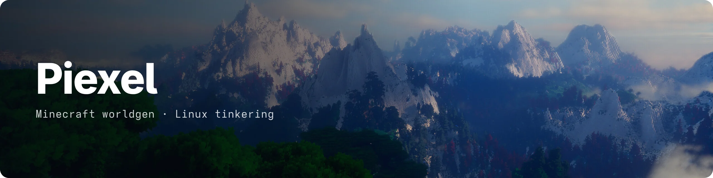
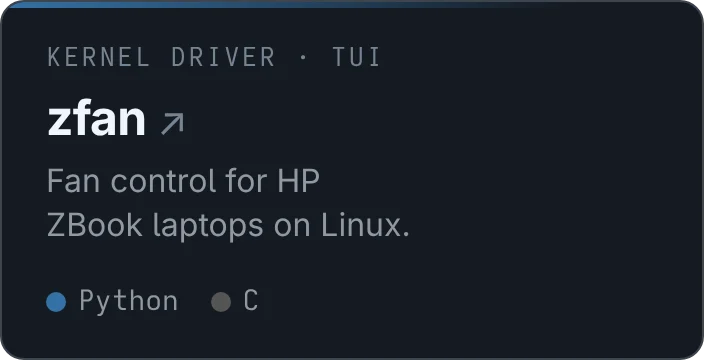

I'm building MCWorldGen, an overhaul of what worldgen means in Minecraft.
Before that I worked on [Iris](https://github.com/VolmitSoftware/Iris).
On the side I make small tools for my own machines and fix bugs in projects I use.

## Things I made

<!--
--><!--
--><!--
--><!--
-->

## Open source

- **[Iris Overworld](https://github.com/IrisDimensions/overworld)**: shipped pack releases V3500 through V3910 with new biomes and regions.
- **[waynote](https://github.com/mryll/waynote/pull/5)**: fixed lost edits on color change and dead input after a surface remap.
