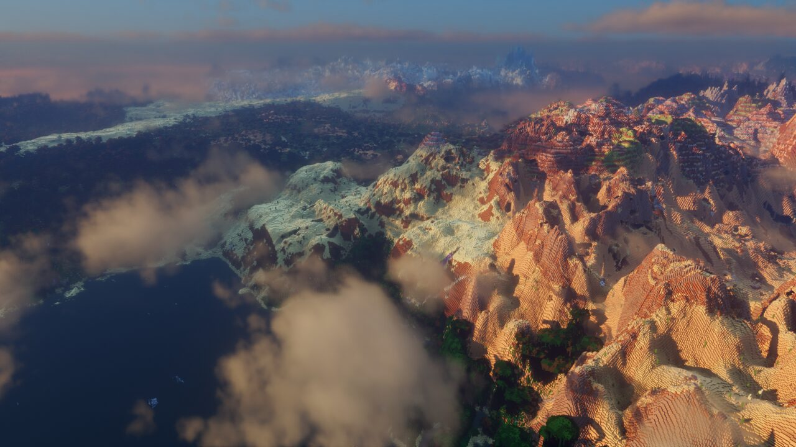
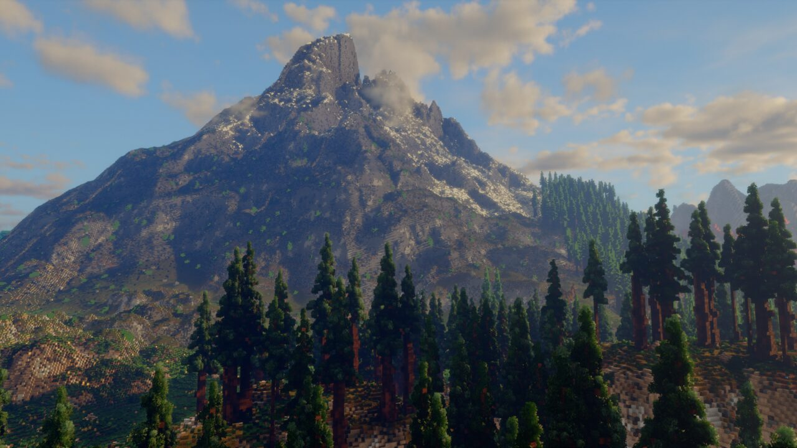
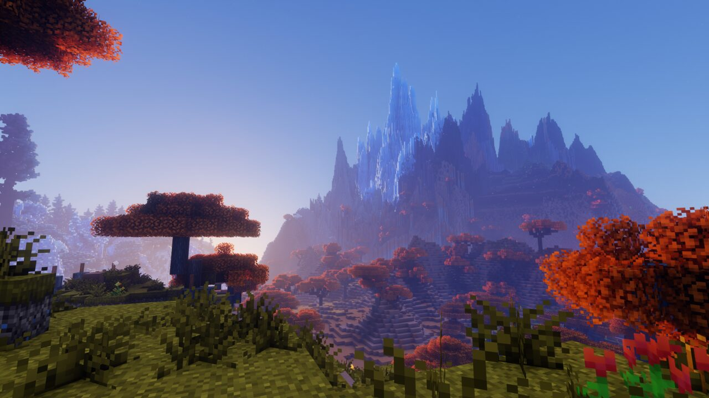

# Hi, I'm Piexel

I'm building MCWorldGen, an overhaul of what worldgen means in Minecraft.
Before that I worked on [Iris](https://github.com/VolmitSoftware/Iris).
On the side I make small tools for my own machines and fix bugs in projects I use.

  
  
  

## Things I made

- **[zfan](https://github.com/piexelated/zfan)**: fan control for HP ZBooks on Linux. A kernel driver and a terminal dashboard.
- **[Codex Provider](https://github.com/piexelated/CodexProvider)**: use your ChatGPT account in JetBrains AI Assistant.
- **[Suwayomi for Paperback](https://github.com/piexelated/paperback-suwayomi)**: read manga from your own Suwayomi server on iOS.

## Open source

- **[Iris Overworld](https://github.com/IrisDimensions/overworld)**: shipped pack releases V3500 through V3910 with new biomes and regions.
- **[waynote](https://github.com/mryll/waynote/pull/5)**: fixed lost edits on color change and dead input after a surface remap.
